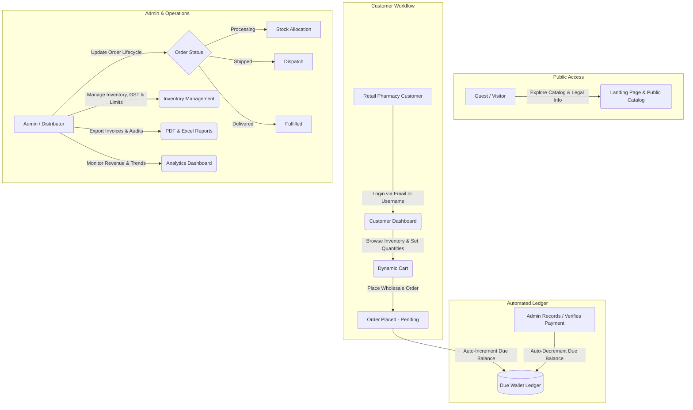

# 💊 Shree Veerabhadreshwara Pharma (SV Pharma)
### Enterprise Pharmaceutical Order, Inventory & Due Management System

🌐 **Live Application:** [https://sv-pharma.vercel.app/](https://sv-pharma.vercel.app/)

---

## 📖 About the Application

**SV Pharma (Shree Veerabhadreshwara Pharma)** is a modern B2B pharmaceutical sales, order lifecycle, and balance management platform. Designed specifically for wholesale pharmaceutical distributors and retail pharmacy clients, SV Pharma replaces traditional, error-prone manual bookkeeping with a centralized, automated digital hub.

The system ensures exact financial accuracy with a **zero-drift Due Wallet ledger**, streamlines multi-stage order dispatch pipelines, manages batch-level medicine inventory with GST calculation, and delivers real-time business intelligence for executive decision-making.

---

## 🔄 Information Workflow



---

## ✨ Core Features & Capabilities

### 🔐 1. Authentication & Access Control
- **Dual-Identifier Login:** Supports login using either a registered **Email address** or a unique **Username**.
- **Role-Based Access (RBAC):** Strict operational segregation between Administrator and Customer accounts.
- **Self-Service Customer Onboarding:** Structured address registration with real-time password strength validation.
- **Automated OTP Account Recovery:** Password reset and username recovery powered by **Brevo (Sendinblue) API** with countdown security timers.
- **Smart Session Handling:** Axios interceptors manage JWT lifecycles and `401 Unauthorized` states without disrupting public legal and catalog routes.
- **Public Legal Compliance:** Dedicated, publicly accessible **Privacy Policy** and **Terms of Service** pages.

### 📦 2. Order Management & Cart Controls
- **Flexible Ordering Pipeline:** Order progression tracking through all operational stages:
  $$\text{Pending} \longrightarrow \text{Processing} \longrightarrow \text{Shipped} \longrightarrow \text{Delivered} \quad (\text{or } \text{Cancelled})$$
- **Admin-Configured Safety Limits:** Global item quantity cap (`maxCartQuantityPerItem`) prevents accidental over-ordering.
- **Manual Numeric Quantity Selector:** Direct numeric quantity inputs for rapid bulk item selection.
- **Smart Filtering Engine:** Order history filtered by **Weekly**, **Monthly**, **Yearly**, and specific lifecycle statuses.

### 💰 3. Automated Due Wallet System
- **Exact Financial Computation:** Zero floating-point drift or rounding discrepancies; all totals, tax amounts, and balances maintain exact 2-decimal precision.
- **Real-Time Automated Ledger:**
  - ➕ **Order Placement:** Automatically increments outstanding customer dues.
  - ➖ **Payment Verification:** Automatically decrements customer dues upon recorded payment.
- **Customer-Grouped Outstanding Dues:** Executive overview grouping balances by customer with instant payment entry modals.
- **Digital & Offline Payments:** Dynamic UPI QR generation with Cloudinary-backed payment receipt upload.

### 💊 4. Inventory & Tax (GST) Management
- **Batch & Expiry Monitoring:** Full visibility into batch numbers, expiry dates, stock quantities, and status badges (*In Stock*, *Low Stock*, *Out of Stock*).
- **Integrated GST Taxation:** Per-medicine GST percentage configuration with automated price transformations.
- **Public Catalog Browsing:** Guests can explore available pharmaceuticals safely via `optionalProtect` middleware.
- **Deduplicated Company Filters:** Clean, dynamically deduplicated manufacturer dropdowns for swift catalog filtering.

### 📊 5. Analytics & Business Intelligence
- **Real-Time Operational KPIs:** At-a-glance cards for Total Orders, Revenue, Total Outstanding Dues, and Active Customers.
- **Interactive Visualizations:** Responsive **Recharts** charts showing chronological monthly revenue trends and volume distributions.
- **Multi-Format Exporting:**
  - 📄 **PDF Reports:** Detailed invoices, customer ledgers, and inventory summaries via `jspdf` & `jspdf-autotable`.
  - 📊 **Excel Workbooks:** `.xlsx` spreadsheets for auditing and accounting workflows.

### ⚙️ 6. Shop Profile & Settings
- **Customizable Business Profile:** Management of GSTIN, Drug License numbers, registered office address, and contact details.
- **Dynamic Site Banners & Links:** Live control over customer announcement banners, footer quick links, and social channels.

### 🎨 7. Responsive UI/UX
- **Shimmer Skeletons:** Custom loading placeholders mirroring actual layout structures for smooth perception.
- **Mobile & Tablet Optimized:** Full-featured drawer menus and responsive sidebars tailored for all screen sizes.
- **Scroll Restoration:** Seamless automatic scroll-to-top on page transitions.

---

## 🛠 Simple Tech Stack

### Frontend
- **Framework & Language:** React 19, TypeScript
- **Build Tool:** Vite
- **Styling:** Tailwind CSS
- **Routing & Motion:** React Router v7, Framer Motion
- **Data Visualization:** Recharts
- **Document & Spreadsheet Export:** jsPDF, jsPDF-AutoTable, XLSX (SheetJS)
- **HTTP Client & Icons:** Axios, React Icons

### Backend
- **Runtime & Server:** Node.js, Express.js (v5)
- **Database:** MongoDB Atlas with Mongoose ODM
- **Authentication & Security:** JWT (JSON Web Tokens), Bcryptjs, Helmet, CORS
- **Email & Notifications:** Brevo (Sendinblue) Transactional Email API
- **Media & File Storage:** Cloudinary, Multer
- **Utilities:** QRCode, Morgan

---

## 📁 Project Structure

```text
SV Pharma/
├── client/              # React 19 + TypeScript Frontend (Vite)
│   ├── src/
│   │   ├── components/  # Admin modals, common UI widgets, skeletons, footer
│   │   ├── context/     # Auth and application global state
│   │   ├── layouts/     # Admin and customer dashboard layouts
│   │   ├── pages/       # Admin, Customer, and Public views
│   │   ├── types/       # TypeScript interfaces
│   │   └── utils/       # API interceptors, export utilities
│   ├── .env.example     # Frontend environment template
│   └── package.json
│
├── server/              # Node.js + Express.js REST API
│   ├── config/          # MongoDB connection configuration
│   ├── controllers/     # Authentication, Orders, Medicines, Payments, Settings
│   ├── middleware/      # JWT verification, Role checks, Error handling
│   ├── models/          # Mongoose database schemas
│   ├── routes/          # API route definitions
│   ├── utils/           # Email templates, token helpers
│   ├── .env.example     # Backend environment template
│   ├── server.js        # Server entry point
│   └── package.json
│
└── README.md            # Application Documentation
```

---

## ⚙️ Environment Configuration

Environment configuration templates are provided in the repository:
- **Backend:** Refer to [`server/.env.example`](file:///f:/SV%20Pharma/server/.env.example) for required database, authentication, and service credentials.
- **Frontend:** Refer to [`client/.env.example`](file:///f:/SV%20Pharma/client/.env.example) for the API endpoint configuration.

---

## 📄 License & Intellectual Property

This project is proprietary software developed for **Shree Veerabhadreshwara Pharma**.  
All rights reserved © 2026. Unauthorized copying, distribution, or reproduction is strictly prohibited.

---

## 👨‍💻 Author & Engineering

Developed for **Shree Veerabhadreshwara Pharma**  
by **Shivanand VN**  
- 🌐 **Live Website:** [https://sv-pharma.vercel.app](https://sv-pharma.vercel.app)
